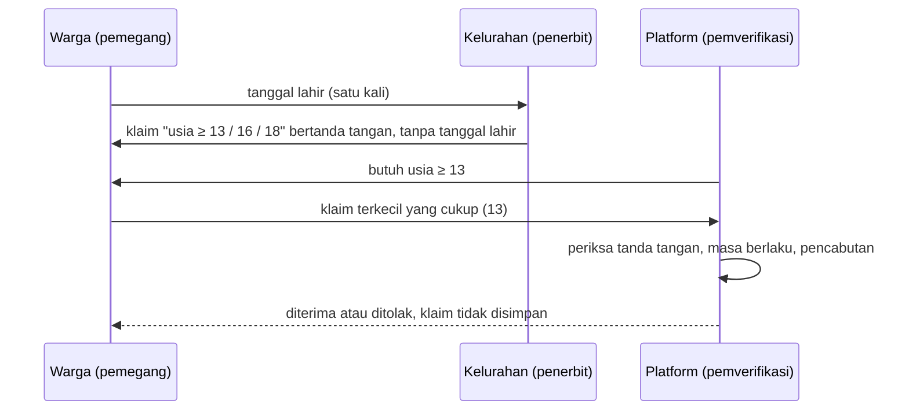

# Bukti Usia: prototipe kedaulatan data dengan tanda tangan digital


Karya 3 dari rangkaian karya filsafat teknologi. Studi *Value Sensitive Design* tentang pertanyaan: bagaimana sebuah platform memenuhi kewajiban memverifikasi usia pengguna tanpa mengumpulkan lebih dari yang perlu?

Prototipe ini sengaja kecil. Ia memakai **tanda tangan digital saja**, bukan *zero-knowledge proof* (ZKP), dan keterbatasannya dijelaskan terang di bawah.

## Gagasan

Tiga peran:

| Peran | Contoh | Melihat apa |
|---|---|---|
| Penerbit | kelurahan, kampus | tanggal lahir, satu kali, saat menerbitkan |
| Pemegang | warga | klaim miliknya sendiri |
| Pemverifikasi | platform | hanya klaim "usia ≥ ambang" dan tanda tangannya |

Penerbit menandatangani pernyataan seperti "pemegang berusia sedikitnya 13 tahun". Tanggal lahir tidak ikut dalam klaim, jadi pemverifikasi tidak dapat menerimanya. Pemegang membawa beberapa klaim (13, 16, 18) dan menyerahkan **yang terkecil yang masih cukup**, supaya tidak membuka lebih dari yang diminta.

### Alur



## Keputusan desain

| Keputusan | Alasan |
|---|---|
| Klaim hanya memuat ambang, bukan tanggal lahir | Minimisasi data: platform tidak perlu tahu kapan seseorang lahir. |
| Skema klaim menolak bidang tambahan | Tanggal lahir tidak bisa diselundupkan ke dalam klaim. |
| Penerbit menolak menerbitkan klaim yang tidak benar | Klaim bertanda tangan harus jujur pada saat diterbitkan. |
| Pemegang memilih klaim terkecil yang cukup | Menyerahkan "≥ 18" untuk kebutuhan "≥ 13" membuka lebih dari perlu. |
| Klaim berumur pendek (bawaan 30 hari) | Membatasi kerugian bila klaim bocor. |
| Daftar pencabutan | Menyediakan jalur koreksi bila data usia ternyata keliru. |
| Pemverifikasi tidak menyimpan klaim | Selaras dengan ketentuan bahwa data verifikasi dipakai untuk verifikasi saja. |

## Dasar hukum yang dirujuk

Dicocokkan dengan teks resmi pada 9 November 2026: UU 27/2022 dari JDIH Kemenkeu dan PP 17/2025 dari JDIH Komdigi. Kedua salinan berasal dari hasil pindaian, sehingga kutipan tetap sebaiknya dibandingkan dengan lembaran negara.

- **UU 27/2022 (Pelindungan Data Pribadi):** Pasal 16 ayat (2) huruf a (pengumpulan terbatas dan spesifik) dan huruf b (pemrosesan sesuai tujuan); Pasal 25 ayat (2) (data anak wajib disetujui orang tua atau wali); Pasal 6 (hak memperbaiki data yang keliru).
- **PP 17/2025 (PP Tunas):** Pasal 20 ayat (2) (rentang usia 3-5, 6-9, 10-12, 13-15, 16 sampai di bawah 18 tahun); Pasal 22 ayat (3) huruf a (melindungi privasi dan data pribadi), huruf e (data hanya untuk verifikasi usia), huruf f (dihapus setelah tujuan terpenuhi), huruf g (mekanisme keberatan atau koreksi); Pasal 22 ayat (2) (tingkat kepastian sesuai risiko).

Prototipe hanya memakai batas 13, 16, dan 18; rentang 3-5, 6-9, dan 10-12 tidak dicakup.

## Keterbatasan

Bagian ini sama pentingnya dengan kodenya.

- **Dapat dikaitkan antarplatform.** Klaim yang sama membawa `id_klaim` yang sama. Dua platform yang menerimanya dapat mencocokkan pengguna. Pendekatan tanda tangan saja tidak mengatasi ini; klaim sekali pakai atau ZKP bisa.
- **Penerbit tetap tahu.** Penerbit melihat tanggal lahir, dan dalam rancangan ini bisa mencatat siapa meminta klaim kapan.
- **Tidak ada pengikatan ke perangkat atau orang.** Klaim bisa dipinjamkan. Prototipe tidak membuktikan bahwa penyaji klaim adalah pemilik klaim.
- **Seluruh klaim terbuka.** Tanda tangan membuktikan keaslian, bukan pengungkapan selektif.
- Penerbit, daftar pencabutan, dan penyimpanan kunci hanya disimulasikan di memori. Ini bukan sistem produksi dan tidak boleh dipakai untuk keputusan tentang orang sungguhan.

Karena itu karya ini berhenti di tanda tangan dan menjadikan ZKP sebagai arah lanjutan, bukan klaim yang sudah dikerjakan.

## Wawancara awal

Kuesioner pilihan ganda lewat WhatsApp, tanpa nama dan sukarela, dijawab 5 orang (4 mahasiswa, semuanya kenalan penyusun). Ini gambaran awal, bukan temuan yang dapat digeneralisasi.

- 4 dari 5 memilih foto KTP sebagai data yang paling berat diberikan untuk membuktikan usia.
- 3 dari 5 merasa lebih tenang bila cukup menunjukkan "di atas 18" tanpa tanggal lahir; 1 justru kurang percaya.
- Tidak ada yang mempercayai platform untuk menyatakan usia; 3 dari 4 yang menjawab memilih orang tua atau diri sendiri, 1 memilih pemerintah.
- Jalur keberatan yang mudah ditemukan adalah kebutuhan yang paling banyak dipilih (3 dari 5).

Temuan kedua dan ketiga menantang asumsi bahwa kelurahan adalah penerbit yang paling dipercaya. Rincian dan keterbatasannya ada di halaman studi.

## Menjalankan

```bash
pip install -r requirements.txt
python demo.py
python -m pytest
```

20 uji otomatis mencakup penerbitan, penolakan klaim palsu, kedaluwarsa, pencabutan, penerbit tak dikenal, penyamaran dengan kunci lain, dan minimisasi.

## Transparansi

Rancangan, kode, dan pengujian disusun dengan bantuan AI (Claude). Pilihan kasus, keputusan desain, dan peninjauan dilakukan oleh saya.

## Lisensi

All rights reserved. Kode ini dapat dibaca dan dipelajari, tetapi tidak boleh disalin atau dipakai ulang tanpa izin tertulis.
